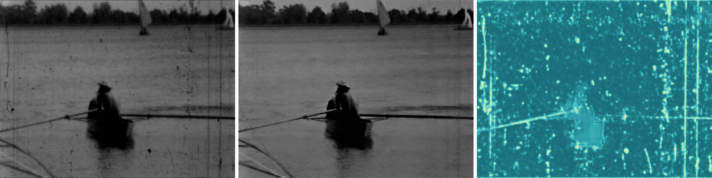
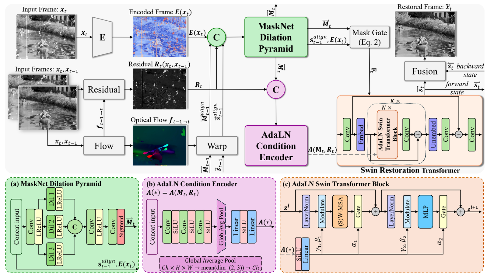

<div align="center">

# DART

### A Degradation-Aware Recurrent Transformer for Archival Film Restoration

**ACCV 2026**

[Mikołaj Jastrzębski](https://www.mikjas.com) · Wojciech Kozłowski · Kamil Adamczewski

Wrocław University of Science and Technology

[](https://arxiv.org/abs/2607.21219)
[](https://absolutecinema.absolutedegradation.workers.dev)
[](https://github.com/TytanMikJas/DART-Degradation-Aware-Recurrent-Transformer/releases/tag/v1.0.0)
[](https://huggingface.co/TytanMikJas/DART-Degradation-Aware-Recurrent-Transformer)
[](https://github.com/TytanMikJas/AbsoluteDegradation)
[](LICENSE)
[](pyproject.toml)



<sub>Real archival footage → DART restoration → predicted soft defect mask (bright = damaged).</sub>

</div>

---

**TL;DR.** DART restores old film by first predicting *where* it is damaged: a supervised defect mask, carried through time, decides what to trust and tells the restoration backbone how damaged each frame is. Small (6.6M parameters) and the best of the seven architectures compared in the paper on the AbsoluteDegradation archival benchmark.

## Contents

- [Quick start](#quick-start)
- [Method](#method)
- [Evaluation](#evaluation)
- [Training](#training)
- [Bring your own model](#bring-your-own-model)
- [Repository layout](#repository-layout)
- [Citation](#citation)

## Quick start

```bash
git clone https://github.com/TytanMikJas/DART-Degradation-Aware-Recurrent-Transformer.git DART
cd DART

uv sync                                       # Python 3.12 (.python-version), exact versions from uv.lock
uv run python scripts/download_weights.py     # pretrained_models/dart.safetensors (52 MB, SHA-256 checked)

# Restore a video file or a folder of frames
uv run python scripts/inference.py --input my_clip.mp4 --output outputs/my_clip --save-masks --save-video
```

You get `frames/` (restored PNGs), `masks/` (predicted defect masks) and `restored.mp4`. Works on a GPU and, slowly, on the CPU. Out of GPU memory? Try a shorter window, e.g. `--chunk-size 5` (the paper uses 7).

<details>
<summary>Without <code>uv</code> (plain pip)</summary>

```bash
python3.12 -m venv .venv && source .venv/bin/activate   # Windows: py -3.12 -m venv .venv; .venv\Scripts\activate
pip install -r requirements.txt
python scripts/download_weights.py
```

Python 3.11–3.13 on Linux, 3.11–3.12 on Windows (pyiqa pins `transformers==4.37.2`, whose `tokenizers` has no Windows wheel for 3.13). PyTorch is installed with CUDA 12.6; for CUDA 12.8 replace `cu126` with `cu128` in `pyproject.toml` or `requirements.txt`.
</details>

## Method

<p align="center"></p>

DART runs over the clip in both directions. At every step a frozen RAFT warps the previous hidden state, mask and frame into the current one, and:

- a **Dilation Pyramid MaskNet** predicts a soft defect mask that gates the fusion: damaged pixels take the propagated state, clean pixels the current frame;
- the mask is **supervised directly** with the ground-truth masks of the [AbsoluteDegradation](https://github.com/TytanMikJas/AbsoluteDegradation) pipeline;
- an **AdaLN-Zero** condition vector built from the mask and the temporal residual modulates every Swin block, so restoration adapts to how damaged the frame is.

## Evaluation

The protocol scores the frames of any model. Download the test sets:

| Set | Source | Default path |
|---|---|---|
| AbsoluteDegradation Real Scene-Split Eval | [Kaggle](https://www.kaggle.com/datasets/absolutedegradation/absolutecinema-real-scene-split-eval) | `data/absolutedegradation_eval/` |
| SRWOV | [MambaOFR repository](https://github.com/MaoAYD/MambaOFR) | `data/srwov/` |
| Synthetic Degraded Eval (with ground truth) | [Kaggle](https://www.kaggle.com/datasets/absolutedegradation/absolutecinema-synthetic-degraded-eval) | `data/synthetic_eval/{degraded,gt}/` |

Clips are folders of frames (`<root>/<clip>/<frame>.png`). Then:

```bash
uv run python scripts/test.py        # restore the test sets -> outputs/results/dart/<set>/<clip>/<frame>.png
uv run python scripts/evaluate.py    # CLIPIQA+, MUSIQ, MANIQA (+ PSNR, SSIM, LPIPS with GT) -> outputs/results/dart/metrics.csv
```

Missing sets are skipped. Paths are Hydra overrides, e.g. `checkpoint.path=<last.ckpt>` tests your own checkpoint and `results_dir=<dir>` scores another folder of restored frames.

## Training

**1. Data and assets.**

```bash
# AbsoluteDegradation v1.0.0 next to this repository (online degradations + ground-truth masks)
git clone --branch v1.0.0 https://github.com/TytanMikJas/AbsoluteDegradation.git ../AbsoluteDegradation
uv pip install -e ../AbsoluteDegradation
uv run python ../AbsoluteDegradation/scripts/download_blue_noise.py
# + the film textures: see "Data preparation" in the AbsoluteDegradation README (-> ../AbsoluteDegradation/data/textures)

uv run python scripts/download_weights.py --extract-raft    # RAFT-Sintel weights for the frozen flow
```

Put REDS `train_sharp` ([download](https://seungjunnah.github.io/Datasets/reds.html)) in `data/REDS/train_sharp/` and the Synthetic Degraded Eval set in `data/synthetic_eval/` (validation). After `uv pip install -e`, use `uv run --no-sync` so that `uv` keeps the editable install.

**2. Train.**

```bash
uv run --no-sync python scripts/train.py                                       # DART, all visible GPUs
uv run --no-sync python scripts/train.py trainer.devices=1                     # one GPU
uv run --no-sync python scripts/train.py trainer.fast_dev_run=true             # smoke test
uv run --no-sync python scripts/train.py --config-name ablation/minus_adaln    # an ablation (see configs/ablation/)
```

The defaults in [`configs/train.yaml`](configs/train.yaml) are the paper's settings. Checkpoints go to `outputs/checkpoints/<run>/`, logs to `outputs/logs/` (`logger=wandb` for Weights & Biases). It runs on Linux, Windows and SLURM clusters (one task per GPU, e.g. `srun python scripts/train.py trainer.devices=2`).

**Reproducibility.** The released model was trained with a pre-release version of AbsoluteDegradation. Version 1.0.0 slightly changes the synthetic training distribution, so retraining yields close but not bit-identical results. The released weights and the evaluation protocol are unaffected.

## Bring your own model

The training loop, the test-time windowing and the metrics do not depend on DART, so any video restoration network (RTN, BasicVSR, your own idea) can be trained and benchmarked here in three steps.

**1. Add the network** to `src/models/my_model/`. Anything that maps a clip `(B, T, 3, H, W)` in [-1, 1] to restored frames of the same shape works:

```python
# src/models/my_model/net.py
import torch
from torch import nn


class MyVideoNet(nn.Module):
    def __init__(self, num_feat: int = 32):
        super().__init__()
        self.body = nn.Sequential(
            nn.Conv3d(3, num_feat, 3, padding=1), nn.ReLU(), nn.Conv3d(num_feat, 3, 3, padding=1)
        )

    def forward(self, frames: torch.Tensor) -> torch.Tensor:  # (B, T, 3, H, W)
        return frames + self.body(frames.transpose(1, 2)).transpose(1, 2)
```

**2. Add two configs** that reuse DART's setup and swap the network:

```yaml
# configs/my_model.yaml (training)
defaults:
  - /train
  - _self_

run:
  name: my_model

my_net:
  _target_: src.models.my_model.net.MyVideoNet
  num_feat: 32

net: ${my_net}  # replaces the DART network
```

```yaml
# configs/test_my_model.yaml (restoring the test sets)
defaults:
  - /test
  - _self_

my_net:
  _target_: src.models.my_model.net.MyVideoNet
  num_feat: 32

net: ${my_net}

frame_output_handler:
  save_root: outputs/results/my_model
```

Your model gets the same data, online degradations, losses (L1 + perceptual + adversarial) and schedule as DART. Mask supervision needs DART's MaskNet, so it is skipped for other networks (you will see a warning once). Flow-based models can reuse the frozen RAFT by adding `optical_flow: ${optical_flow}` to `my_net`.

**3. Train, restore, score.**

```bash
uv run --no-sync python scripts/train.py --config-name my_model
uv run --no-sync python scripts/test.py --config-name test_my_model checkpoint.path=outputs/checkpoints/my_model/<date>/last.ckpt
uv run --no-sync python scripts/evaluate.py results_dir=outputs/results/my_model
```

`checkpoint.path` also takes a plain `.pth` state dict, e.g. official pretrained weights if your module keeps their parameter names. Already have restored frames from another codebase? Lay them out as `<dir>/<set>/<clip>/<frame>.png` and run only the last line.

## Repository layout

```
DART/
├── configs/
│   ├── train.yaml                 # DART training (paper configuration)
│   ├── ablation/                  # Table 4: one override per removed component
│   ├── model/                     # architecture (dart.yaml) and loss weights (losses.yaml)
│   ├── degradation.yaml           # online AbsoluteDegradation pipeline
│   ├── test.yaml                  # restore the evaluation sets
│   └── evaluate.yaml              # score restored frames (any model)
├── scripts/
│   ├── inference.py               # restore your own clip (frames or video)
│   ├── download_weights.py        # fetch + verify the pretrained weights
│   ├── train.py · test.py · evaluate.py
├── src/
│   ├── models/dart/               # MaskNet, gated aggregation, AdaLN Swin blocks, backbone, loss
│   ├── models/generic/            # adversarial training / chunked test loop
│   ├── models/optical_flow/       # frozen RAFT (unmodified official code in third_party/)
│   ├── data/                      # datasets + online degradation connector
│   ├── losses/ · metrics/ · utils/
└── pretrained_models/             # downloaded weights
```

## Citation

```bibtex
@inproceedings{jastrzebski2026dart,
  title     = {{DART}: A Degradation-Aware Recurrent Transformer for Archival Film Restoration},
  author    = {Jastrz{\k{e}}bski, Miko{\l}aj and Koz{\l}owski, Wojciech and Adamczewski, Kamil},
  booktitle = {Asian Conference on Computer Vision (ACCV)},
  year      = {2026}
}
```

DART is trained and evaluated with AbsoluteDegradation:

```bibtex
@inproceedings{jastrzebski2026absolutedegradation,
  title     = {{AbsoluteDegradation}: A Physics-Inspired Synthetic Film-Degradation Pipeline and Archival Film Restoration Benchmark},
  author    = {Jastrz{\k{e}}bski, Miko{\l}aj and Glinkowski, Dawid and Zieli{\'n}ski, Dawid and Borkowski, Daniel and Koz{\l}owski, Wojciech and Adamczewski, Kamil},
  booktitle = {Advances in Neural Information Processing Systems (NeurIPS), Evaluations and Datasets Track},
  year      = {2026}
}
```

GitHub's *Cite this repository* button uses [`CITATION.cff`](CITATION.cff).

## Acknowledgements

We gratefully acknowledge Polish high-performance computing infrastructure PLGrid (HPC Center: ACK Cyfronet AGH) for providing computer facilities and support within computational grant no. PLG/2025/018640.

DART builds on [RAFT](https://github.com/princeton-vl/RAFT), [SwinIR](https://github.com/JingyunLiang/SwinIR) and the recurrent design of [RTN](https://github.com/raywzy/Bringing-Old-Films-Back-to-Life). Training uses [REDS](https://seungjunnah.github.io/Datasets/reds.html), and the archival benchmark is built from public-domain films of the [Library of Congress](https://www.loc.gov). We thank the authors and institutions for making their work available.

## License

The code and the DART weights are released under the [MIT License](LICENSE). Third-party components keep their own licenses ([`THIRD_PARTY_LICENSES.md`](THIRD_PARTY_LICENSES.md)): the RAFT code and the RAFT-Sintel weights bundled in the checkpoint (BSD-3-Clause), adapted SwinIR blocks (Apache-2.0) and the datasets (REDS: CC BY 4.0).

Questions and issues: open a [GitHub issue](https://github.com/TytanMikJas/DART-Degradation-Aware-Recurrent-Transformer/issues) or write to contact@mikjas.com.
